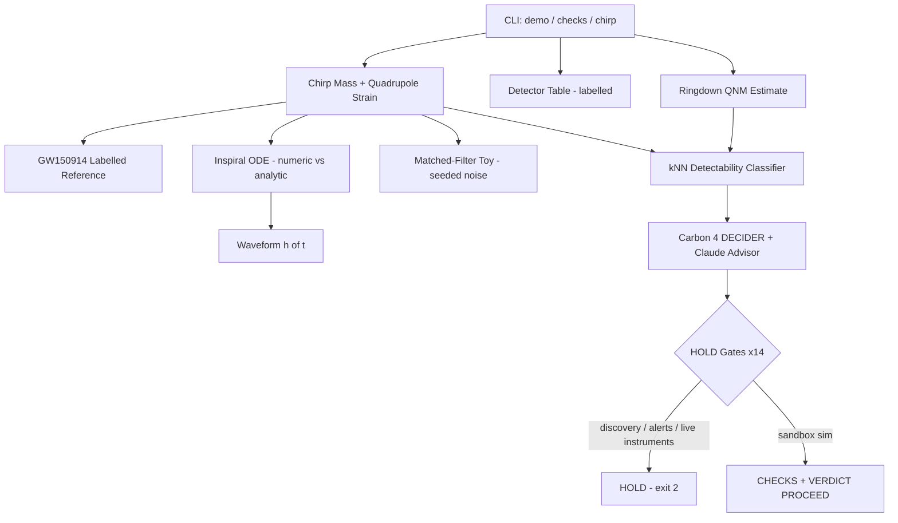
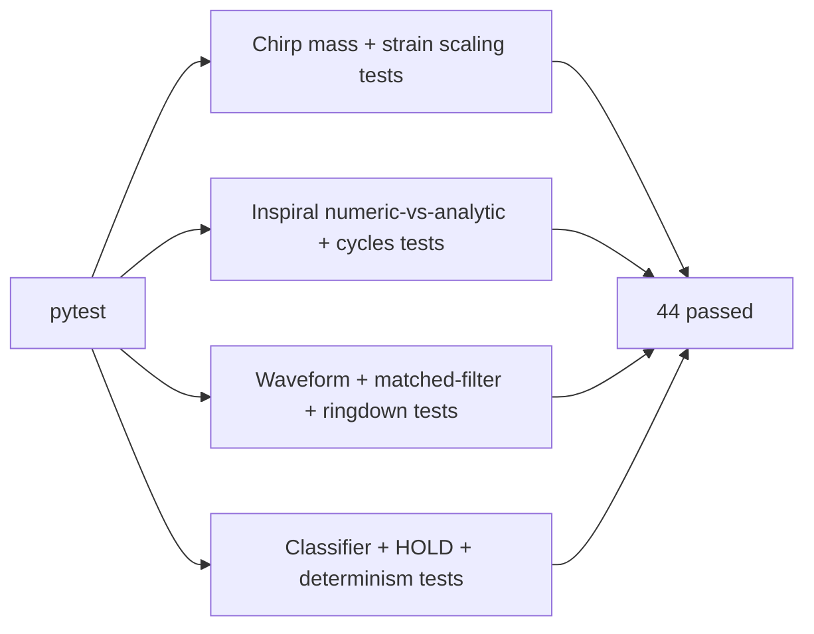
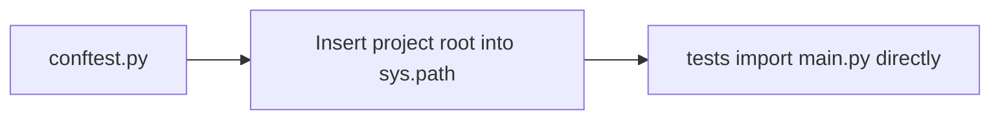
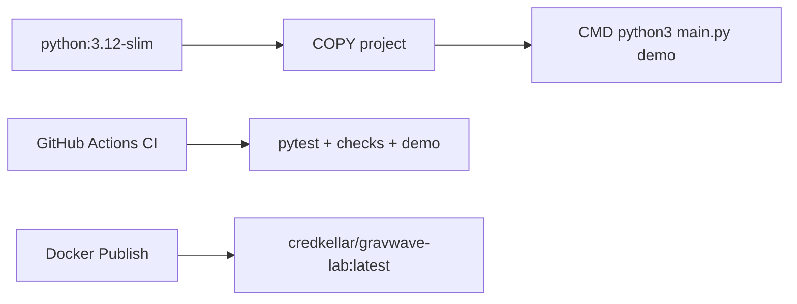

# GravWave-Lab 🌊⚛️

**Gravitational Wave Astronomy Lab** — an educational gravitational-wave lab in ONE pure-Python file, by Darion Kellar. The **chirp mass** and the **quadrupole-formula strain** h = 4 (G Mc)^(5/3) (π f)^(2/3) / (c⁴ r), the **inspiral chirp** integrated from the quadrupole energy-loss ODE and checked against its closed forms, a growing-amplitude **waveform**, a **matched-filter toy** with seeded noise that proves the √(time) SNR law, a labelled **detector comparison table**, the Schwarzschild **ringdown** quasi-normal-mode estimate, and a from-scratch **kNN detectability classifier**. And the honest headline: **GW150914's numbers are labelled published literature values, never "measured here"** — this lab fetches no detector data and claims no discovery. Simulation and learning only — every real-world operation and every discovery claim sits behind a permanent HOLD gate (14 total). 🔒


> ℹ️ The two workflow badges above are the **live** GitHub Actions badges for this repo — they light up as soon as the `ci.yml` and `docker-publish.yml` files from the paste pack are pasted into `.github/workflows/`.

## 🧰 Tech Stack Badges & Full Architecture Tech Stack

### 💻 Core Programming Languages & Core Systems


- 🐍 Python 3.12, pure standard library (`math`, `hashlib`, `json`, `random`, `sys`) — ONE file: `main.py`
- 🌊 Physics core: chirp mass + quadrupole strain, inspiral chirp ODE (deterministic log-grid trapezoid integration, asserted against the analytic time-to-coalescence and cycles formulas), analytic-phase waveform sampler, seeded matched-filter SNR toy, Schwarzschild QNM ringdown estimate
- 🧠 TinyML kNN detectability classifier (from scratch, stdlib) on (log₁₀ chirp mass, log₁₀ distance, log₁₀ frequency) — trained on a grid labelled by the strain model itself
- 🧑‍⚖️ Advisory seats inside `main.py`: Gemini Carbon 4 DECIDER (names-only, tighten-only, sha256 trace), Muse advisor (can_override_hold = False), Google Flow plan-only (rendered = False, live = 0)

### ⛓️ Web3 & Infrastructure

Not used — this lab is an offline physics simulation. No blockchain, no Web3 libraries, no network calls of any kind.

### ⚙️ Platform Support & Hardware Architecture


- 🖥️ Runs anywhere Python 3.12 runs — Linux, macOS, Windows, any CPU architecture
- 🚫 Controls **no hardware**: no interferometers, lasers, vacuum systems, or space instruments (all behind HOLD gates)

### ⚡ Low-Level Infrastructure & Performance


- 🚀 Zero dependencies, zero network, zero install friction for the lab itself
- 🎯 Deterministic end to end: the chirp integration is a fixed log-grid trapezoid, the matched-filter noise is a fixed-seed PRNG — run it twice, get byte-identical output
- 🔢 Closed-form physics wherever it exists; the only iterations are the trapezoid integrations and the kNN sort

### 🛠️ DevOps & Build Tools


- 🐳 Docker image (`python:3.12-slim`), target: `credkellar/gravwave-lab:latest`
- ⚙️ GitHub Actions CI + Docker Publish workflows — delivered in the paste pack for `.github/workflows/`

### ☁️ Cloud Providers

Not used — this lab runs fully offline on your own machine or in a local Docker container. No cloud account, no API keys, no hosted services.

## What this does?

1. 🔗 **Chirp mass** — the mass combination the wave actually measures: Mc = (m1 m2)^(3/5) / (m1 + m2)^(1/5). GW150914's 36 + 29 solar masses give Mc = 28.10 Msun, matching the published 28.1 — the first number LIGO ever read off a waveform, reproduced here from the masses alone.
2. 📏 **Quadrupole strain** — h = 4 (G Mc)^(5/3) (π f)^(2/3) / (c⁴ r). At 410 Mpc the lab's optimal-orientation estimate grows 8.05×10⁻²² (35 Hz) → 2.13×10⁻²¹ (150 Hz). The scaling laws are asserted exactly: h ∝ f^(2/3), h ∝ Mc^(5/3), and h ∝ 1/r — *not* 1/r², because detectors feel amplitude.
3. 🏷️ **GW150914, labelled** — the published reference (Abbott et al. 2016): peak strain 1.0×10⁻²¹, peak frequency ~150 Hz, distance ~410 Mpc, remnant 62 Msun. The lab prints its own 2.13×10⁻²¹ estimate *next to* the published 1.0×10⁻²¹ and names the gap: inclination / antenna-pattern averaging. Published values are data with a label, never a claim of measurement.
4. 🎵 **Inspiral chirp, integrated** — df/dt = (96/5) π^(8/3) (G Mc/c³)^(5/3) f^(11/3), integrated on a deterministic log grid and asserted against the closed forms: GW150914 chirps 35 → 150 Hz in 0.186 s and 9.7 GW cycles; from 10 Hz it is 5.36 s and 84.9 cycles. ISCO frequency for 65 Msun: 67.6 Hz.
5. 🐚 **The neutron-star contrast** — a 1.4 + 1.4 Msun binary (Mc = 1.219) takes 1002 s from 10 Hz and piles up **16,003 cycles** between 10 and 400 Hz. Same ODE, wildly different song — and the cycle count is exactly what a matched filter banks.
6. 🌊 **Waveform h(t)** — 763 samples at 4096 Hz: analytic f(t) = f₀(1 − t/t_c)^(−3/8), phase by trapezoid integration, amplitude from the strain formula at the instantaneous frequency. The envelope is asserted monotonic and its endpoint asserted equal to the strain formula — the picture can never drift from the physics.
7. 🎧 **Matched-filter toy** — a template of amplitude 1 buried in seeded noise of σ = 5: SNR 13.86 after 10 s (analytic 14.14), 28.63 after 40 s — ratio 2.07 vs the √(4) = 2.00 the square-root law predicts. Noise alone scores −0.28: no signal, no detection. The noise is a fixed-seed PRNG, labelled, and is *not* detector data.
8. 🔭 **Detector table, labelled** — published reference sensitivities as rounded class figures: LIGO's two 4 km instruments (~1e-23 /√Hz class, ~1e-19 m displacement class), Virgo and KAGRA at 3 km, and the planned LISA at 2.5 million km for the millihertz band. Plus the one derived number: published peak strain × 4 km = **4.0×10⁻¹⁸ m** of mirror motion.
9. 🔔 **Ringdown** — the Schwarzschild l = m = 2 quasi-normal mode (labelled formula, Mω = 0.3737 − 0.0890 i): a 62 Msun remnant rings at 194.8 Hz with τ = 3.43 ms and Q = 2.10 — the Q identity Q = 0.3737/(2 × 0.0890) is asserted. GW150914's *spinning* remnant rang at ~251 Hz published; spin raises the frequency, and the lab says so instead of fudging the constant.
10. 🏷️ **kNN detectability classifier** — labels any (chirp mass, distance, frequency) point `detectable` / `marginal` / `undetectable`. Its training grid is labelled by the strain model itself, so it interpolates the quadrupole formula's own verdicts: GW150914-like → detectable, the same binary at 4 Gpc and 60 Hz → marginal, a neutron-star binary at 400 Mpc → undetectable.
11. 🧠 **Advisory seats + checks** — Carbon 4 DECIDER with sha256 trace, Muse advisor, Google Flow plan-only, and a built-in CHECKS suite (61 checks).

## 🗺️ How it works — diagram per script

### `main.py` — the whole lab



### `tests/test_main.py` — verification



### `conftest.py` — test path setup



### `Dockerfile` + CI — container & workflow flow



## Why is this cool?

1. 🌊 Spacetime itself is the instrument's target: two black holes a billion light-years away moved LIGO's mirrors by 4×10⁻¹⁸ m — and the arithmetic that predicts that number fits in one file here.
2. 🎵 The chirp is a fingerprint: from the frequency sweep alone you can read off the chirp mass to match the published value — mass measured with a stopwatch and a ruler made of light.
3. 📈 Amplitude falls as 1/r, not 1/r²: double the distance only halves the strain, which is why detectors hear across billions of light-years — and why *volume* grows so fast with sensitivity.
4. 🐚 One ODE, two songs: black holes chirp for a fifth of a second; neutron stars sing for ~17 minutes and stack 16,003 cycles — and the lab integrates both and checks them against the closed forms.
5. 🎧 Matched filtering is a superpower with a receipt: a signal 5× under the noise floor per sample becomes SNR ~14 just by knowing the waveform's shape — and the √(time) law is demonstrated, not asserted.
6. 🔔 Dead black holes ring like bells at frequencies set only by their mass: 195 Hz for 62 suns, 1207 Hz for 10 — one labelled constant pair (0.3737, 0.0890) prices the whole bell tower.
7. 🏷️ The classifier is taught by the physics itself: its training labels come from the strain formula, so the ML can never hallucinate a verdict the quadrupole law wouldn't give.
8. 🔭 It puts the whole observatory fleet on one page — 4 km ground arms for the audio band, a 2.5-million-km space triangle for the millihertz band — with every sensitivity labelled as the published class figure it is.
9. 🚫 It refuses the hype by construction: no discovery claims, no fake data, no alerts — 14 HOLD gates, and the published-vs-computed strain gap is explained instead of hidden.
10. 🎯 Deterministic end to end: fixed-grid integration, fixed-seed noise — run it twice, get byte-identical output. Astronomy you can diff.

## What problems this solves?

1. ❌ **Problem:** Gravitational-wave numbers (1e-21) are impossible to intuition-check. ✅ **Solution:** One strain table runs 20 → 150 Hz at a real event's distance, and the mirror-displacement product (4.0×10⁻¹⁸ m) turns the dimensionless strain into a length you can compare to a proton.
2. ❌ **Problem:** "Chirp mass" is quoted everywhere and derived nowhere. ✅ **Solution:** The lab computes Mc from the component masses and shows it landing on the published 28.1 Msun for GW150914.
3. ❌ **Problem:** People assume GW signals fade as 1/r² like light. ✅ **Solution:** The 1/r amplitude law is asserted numerically (10× farther = exactly 0.1× strain) with the detector consequence spelled out.
4. ❌ **Problem:** Inspiral lifetimes get hand-waved ("it chirps quickly"). ✅ **Solution:** The ODE is integrated deterministically *and* checked against the analytic t_c and cycle-count formulas — 0.19 s for GW150914's last sweep, 1002 s for a neutron-star binary.
5. ❌ **Problem:** Matched filtering sounds like magic or cheating. ✅ **Solution:** The toy buries a known template in seeded noise 5× louder per sample and recovers it at the SNR the formula predicts, with the √(time) scaling measured between two durations.
6. ❌ **Problem:** Simulated "data" gets passed off as detector data. ✅ **Solution:** The noise is a fixed-seed PRNG labelled in code, demo, and docs; real detector data claims are a permanent HOLD gate.
7. ❌ **Problem:** Ringdown is treated as a mysterious postscript. ✅ **Solution:** The QNM estimate prices frequency, damping time, and Q for any remnant mass from one labelled formula — and labels the spin caveat against GW150914's published 251 Hz.
8. ❌ **Problem:** Detector sensitivities are quoted as promises or live status. ✅ **Solution:** The table stores rounded published class figures with an explicit `labelled` flag on every row.
9. ❌ **Problem:** Physics code usually needs numpy / scipy installs. ✅ **Solution:** Pure standard library — the integrations are hand-rolled trapezoids; runs anywhere Python 3.12 runs, zero pip installs for the lab itself.
10. ❌ **Problem:** Simulation tools quietly imply discovery readiness. ✅ **Solution:** Published values are labelled as literature, model conventions (optimal orientation, Schwarzschild ringdown) are named in the open, and 14 HOLD gates return exit code 2 for every live operation, alert, and discovery claim.

## How to install this?

1. 📋 Clone or download this project folder.
2. 🐍 Make sure Python 3.12+ is installed: `python3 --version`
3. ▶️ Run the full demo + checks (no arguments needed):

```bash
python3 main.py
```

4. 🧪 Run the test suite:

```bash
pip install pytest
python3 -m pytest -q
```

5. 🎛️ Try the other commands:

```bash
python3 main.py checks    # 61 built-in checks
python3 main.py chirp     # chirp mass + GW150914 report + strain table as JSON
python3 main.py inspiral  # numeric vs analytic chirp: BBH + BNS as JSON
python3 main.py waveform  # waveform summary as JSON
python3 main.py filter    # matched-filter SNR report as JSON
python3 main.py detectors # labelled detector table as JSON
python3 main.py ringdown  # QNM ringdown table as JSON
python3 main.py classify  # kNN detectability verdicts
python3 main.py brains    # Carbon 4 + Muse + Flow seats
python3 main.py holds     # list all 14 HOLD gates
python3 main.py hold-demo # exits 2 - gated actions stay HOLD
```

6. 🐳 Or run it in Docker:

```bash
docker build -t credkellar/gravwave-lab:latest .
docker run --rm credkellar/gravwave-lab:latest
```

## Requirements

- 🐍 Python 3.12 or newer
- 📦 Dependencies: **none** (standard library only)
- 🌐 Network: **none** — fully offline
- 🧪 For tests only: `pytest`
- 🐳 Optional: Docker

## FULL project structure tree

```text
gravwave-lab/
├── main.py                  # the whole lab: chirp mass, quadrupole strain, GW150914 reference, inspiral ODE, waveform, matched filter, detectors, ringdown, classifier, seats, HOLD gates
├── conftest.py              # puts the project root on sys.path for tests
├── tests/
│   └── test_main.py         # 44 pytest tests: chirp mass, strain scalings, inspiral, waveform, matched filter, ringdown, classifier, gates, determinism
├── assets/
│   └── cover.png            # README cover image (2736 x 912)
├── Dockerfile               # python:3.12-slim, runs the demo
├── .gitignore               # __pycache__, .pytest_cache, *.pyc
└── README.md                # this file
```

> 📦 Delivered separately as paste packs (not in this tree): `.github/workflows/ci.yml` + `docker-publish.yml`, and the Docker Hub pack (100-char description, 350-char About, overview, categories).

## 🔒 HOLD gates — all 14, permanent

| Gate | Rule |
|---|---|
| discovery_claim | No claim that this simulation discovered a gravitational-wave event; discoveries belong to the detector collaborations |
| real_detector_data_claim | No real strain data is fetched, downloaded, or analysed here, and none may be claimed |
| live_detector_control | No control of LIGO, Virgo, KAGRA, LISA, or any real instrument, ever |
| event_alert_issuance | No issuing of event alerts, GCN circulars, or public detection notices from a simulation |
| measured_here_claim | Published event numbers in this lab are labelled literature values, never "measured here" |
| peer_reviewed_result_claim | No claim of a peer-reviewed result; this is an educational simulation |
| commercial_product_claim | Educational lab, not a commercial product or detector design service |
| investment_claim | No investment advice about aerospace, detector, or space-mission companies |
| guaranteed_detector_performance_claim | No guaranteed detector performance; labelled sensitivities are published reference values, not promises |
| faster_than_light_claim | Gravitational waves propagate at c; no faster-than-light signalling claims |
| gravity_control_claim | No antigravity, gravity shielding, or spacetime-manipulation claims; waves are computed, not controlled |
| time_travel_claim | No time-travel claims; a ripple in spacetime is not a time machine |
| weapons_application_claim | No weapons application guidance of any kind |
| medical_claim | No medical claims; gravitational-wave astronomy treats no condition |

🧑‍⚖️ **Seats:** Gemini Carbon 4 DECIDER (MAP→MODEL→STRESS→DECIDE, names-only, tighten-only, sha256 trace) · Muse advisor (can_override_hold = False) · Google Flow plan-only (rendered = False, live = 0).

✅ **Verification:** pytest 44 passed · CHECKS 61/61 · double-run byte-identical · hold-demo exits 2.

## 🧒 5th-grade English section

Imagine the universe is a giant trampoline. When two very heavy balls — heavier than the Sun — roll around each other and crash, the trampoline shakes. Those shakes travel across space as waves. 🌊

- The waves are tiny. When one passes Earth, it stretches and squeezes everything by less than the width of an atom's smallest piece. 🔬
- Scientists built giant L-shaped rulers with lasers, 4 kilometers long, to catch the shakes. The first catch was in 2015: two black holes crashing far, far away. 🔭
- As the two balls spiral closer, the shaking gets faster and stronger — it sounds like a bird's chirp going up. Physicists call it a **chirp**, and from the chirp they can weigh the balls! 🎵
- After the crash, the new bigger ball wobbles like a ringing bell, slower and slower, until it is quiet. 🔔
- The signal is so quiet that scientists use a trick: they compare what they hear with the exact chirp shape they expect, and the matching parts add up. The longer they listen, the clearer it gets. 🎧
- This project is a **pretend lab on a computer**. It does the math of the waves — it does not run a real detector or discover anything. The famous numbers in it come from real science books, and they are labelled that way. 💻

---

MIT © 2026 Darion Kellar · GravWave-Lab — educational simulation only 🌊
